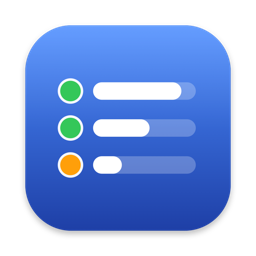

<p align="center">
  
</p>

<h1 align="center">Slurm Monitor</h1>

<p align="center">
  A macOS menu-bar app that shows your Slurm jobs across all your
  Compute Canada / Digital Research Alliance clusters in one floating panel.
</p>

---

## Why

Checking jobs normally means SSH-ing into each cluster and running `sq`. On Alliance clusters every SSH login requires **MFA (Duo/YubiKey)**, and connections drop when your Mac sleeps or changes network, so you approve Duo over and over.

Slurm Monitor logs in **once per cluster**, keeps that authenticated SSH connection alive as long as possible, and reuses it for every refresh. When a connection does drop, the panel keeps showing your last known jobs (marked stale) and waits for you to click **Log in**. It never fires a Duo push on its own.

## Features

- **Menu-bar summary:** `▶ 5  ⏸ 3` (running / pending across all clusters), with an orange dot when some data is stale.
- **Floating panel** (Zest-style), resizable from the bottom-right grip:
  - **Overview:** totals and GPUs in use, *Ending soon*, *Waiting* (reason + estimated start), *Recently ended (last 3)* with final state, and a cluster status grid.
  - **Jobs:** every queued/running job grouped by cluster, with time bars, resources and expandable details.
  - **Clusters:** connection status, error hints, **Log in**, edit/remove, add cluster.
- **Read-only:** it never cancels, holds or modifies jobs.
- **One shared connection per cluster:** reuses your existing `ControlMaster` sockets if you have them, so a login in Terminal or in the app saves a login in the other.
- **Keep-alive:** SSH keep-alives every 30 s, a background refresh every 5 min, and an optional *Stay awake while plugged in* mode.
- **Built-in Alliance presets:** nibi, fir, narval, rorqual, trillium, trillium-gpu, tamia, killarney. Any other Slurm cluster reachable over SSH works too.
- **Safe with your SSH setup:** never writes `~/.ssh/config`, never closes connections you are using, never stores passwords, passphrases or MFA codes.

## Requirements

- macOS 14 (Sonoma) or later, Apple Silicon or Intel
- An Alliance (CCDB) account with MFA set up
- For Trillium / Trillium-GPU: an SSH key uploaded to CCDB (password login is disabled there) and Trillium access requested in CCDB

## Install

### Option A: download a release

1. Open the repository's **Releases** page and download `SlurmMonitor-<version>-macOS.zip`.
2. Unzip it and move **Slurm Monitor.app** to `/Applications`.
3. The app is ad-hoc signed (not notarized by Apple), so macOS blocks the first launch. Either right-click the app → **Open** → **Open**, or run:

   ```bash
   xattr -dr com.apple.quarantine "/Applications/Slurm Monitor.app"
   ```

4. Open it. Look for `▶ 0  ⏸ 0` in the menu bar (top right). The icon also appears in the Dock; clicking it opens the panel.

### Option B: build from source

Requires the Xcode Command Line Tools (`xcode-select --install`) or Xcode.

```bash
git clone <this-repo-url>
cd compute_canda_job_monitor
./scripts/build-app.sh                              # builds and signs build/Slurm Monitor.app
cp -R "build/Slurm Monitor.app" /Applications/
open "/Applications/Slurm Monitor.app"
```

## First-time setup

The first time you open the panel you'll see **Add your clusters**.

### 1. Choose how to add clusters

| Tab | Use when |
|---|---|
| **Alliance clusters** (default) | Fresh Mac or no SSH config. Enter your **Alliance username** once (your cluster login name, not your email) and keep the clusters you use ticked. |
| **Import SSH config** | You already have `Host` entries in `~/.ssh/config`. Alliance/SciNet hosts are pre-selected. Only shown when that file has hosts. |
| **Custom host** | Any other Slurm cluster: name, host, username, optional SSH alias / identity file. |

### 2. SSH key

The same screen checks for an SSH key (`~/.ssh/id_ed25519`, `id_ecdsa`, `id_rsa`, or a key loaded in `ssh-agent`).

- **Key found:** nothing to do.
- **No key:** click **Create a key for me** (passphrase optional, never stored). Then click **Copy**, then **Open CCDB SSH keys page**, and paste the public key into CCDB. New keys can take a while to reach the clusters.
- **Skip:** most clusters also accept your CCDB password + MFA. Trillium and Trillium-GPU require a key and will show *needs SSH key* until one works.

### 3. Log in

Click **Log in to all**. The app goes through the clusters one at a time in a login window:

1. **Host key** (first contact only): check the fingerprint and click **Trust**.
2. **Password or key passphrase**, if asked.
3. **Duo menu:** click e.g. **1 · Duo Push** (or type a passcode) and approve on your phone.
4. **Connected**, then it moves to the next cluster.

Use **Skip this cluster** or **Stop** at any time. Clusters you skip show *needs login* with a **Log in** button in the **Clusters** tab.

### 4. Optional: share connections with Terminal

- **Imported from `~/.ssh/config` with `ControlPath` set:** the app already uses the same sockets, so `ssh nibi` in Terminal reuses the app's login (and vice versa).
- **Fresh setup:** open **Clusters → Edit** on a cluster and click **Copy snippet**. Paste it into `~/.ssh/config` yourself so Terminal reuses the app's connection.

## Daily use

- Open the panel any time; data older than 60 s refreshes automatically, and **⟳** refreshes now.
- After a long sleep, a closed lid or a Wi-Fi/VPN change, connections can't survive (a new MFA login is required). Affected clusters turn **◐ stale**, keep showing their last jobs, and wait for you to click **Log in** (or **Log in to stale clusters**).
- Status dots: **●** live · **◐** stale (with age) · **○** needs login, needs SSH key, no access, unreachable or MFA failed.

## Settings (⚙)

| Setting | Default | What it does |
|---|---|---|
| Refresh interval | 5 min | Background refresh, which also keeps connections active |
| Stay awake while plugged in | Off | Prevents idle sleep on AC power while at least one cluster is live. Doesn't prevent lid-close sleep. |
| Show in Dock | On | Dock icon (click to open the panel). The menu-bar item is always shown. |
| Launch at login | Off | Starts the app at login (works when installed in `/Applications`) |

Panel size: drag the grip in the bottom-right corner; double-click it to reset.

## Files

| Path | Contents |
|---|---|
| `~/.slurm-monitor/clusters.json` | Your cluster list |
| `~/.slurm-monitor/cache/` | Last known job snapshot per cluster (shown while offline) |
| `~/.slurm-monitor/ssh_config` | App-generated SSH config (derived from your `~/.ssh/config` via `ssh -G`) |
| `~/.slurm-monitor/cm-*` | App-owned connection sockets (when you don't already have a `ControlPath`) |

To reset the app completely: quit it and delete `~/.slurm-monitor`.

## How it works

- Jobs come from one SSH round-trip per cluster running plain `squeue` (queued/running), `squeue --start` (estimated starts) and `sacct -S now-7days` (recently ended jobs). `sq` is Alliance-only, so the app doesn't depend on it.
- Queries run with `BatchMode=yes` and `ControlMaster=no` through the existing shared connection, so they can never trigger a password or MFA prompt.
- Logins run `ssh` inside a pseudo-terminal in the app's login window, so prompts appear in the app instead of a Terminal popup.
- A stale connection is released with `ssh -O stop`, never `-O exit`, so Terminal sessions already using it keep working.

## Troubleshooting

| Symptom | Fix |
|---|---|
| *needs SSH key* | Upload your public key in CCDB (CCDB → SSH Keys) and wait for it to propagate. |
| *no access* | Request access to that cluster in CCDB (needed for Trillium). |
| *MFA failed* | The Duo request was denied or timed out. Click **Log in** again. |
| Clusters go stale often | Turn on **Stay awake while plugged in**. Network changes and long sleeps always need a new login. |
| App won't open after download | Remove the quarantine flag (see Install, step 3). |
| Crash | Send `~/Library/Logs/DiagnosticReports/SlurmMonitorApp-*.ips` with your bug report. |

## Development

```bash
swift build                     # debug build
./scripts/build-app.sh          # release .app bundle in build/
swift scripts/make-icon.swift   # regenerate Resources/AppIcon.icns
```

Tests use Swift Testing. With full Xcode, run `swift test`. With only the Command Line Tools:

```bash
swift test --enable-swift-testing --disable-xctest \
  -Xswiftc -F -Xswiftc /Library/Developer/CommandLineTools/Library/Developer/Frameworks \
  -Xlinker -F -Xlinker /Library/Developer/CommandLineTools/Library/Developer/Frameworks \
  -Xlinker -rpath -Xlinker /Library/Developer/CommandLineTools/Library/Developer/Frameworks \
  -Xlinker -rpath -Xlinker /Library/Developer/CommandLineTools/Library/Developer/usr/lib
```

Project layout:

- `Sources/SlurmMonitorCore`: models, Slurm parsing, SSH config/ControlPath resolution, transports, refresh logic, login session (UI-free, unit-tested)
- `Sources/CPTYHelper`: small C helper that spawns `ssh` with a controlling terminal
- `Sources/SlurmMonitorApp`: SwiftUI menu-bar app
- `docs/superpowers/`: design spec and implementation plan

### Releasing

Push a version tag; GitHub Actions ([`.github/workflows/release.yml`](.github/workflows/release.yml)) runs the tests, builds the app, and publishes a release with the app zip, a source zip and `SHA256SUMS.txt`:

```bash
git tag v0.1.0 && git push origin v0.1.0     # tags with a hyphen (v0.2.0-beta.1) become pre-releases
```

## Roadmap

- **Robot (automation) node connections:** MFA-free access via Alliance automation nodes, using a restricted CCDB key tied to a fixed source IP. The settings and UI already reserve a slot for it.
- Developer ID signing and notarization, so downloads open without the quarantine step.
